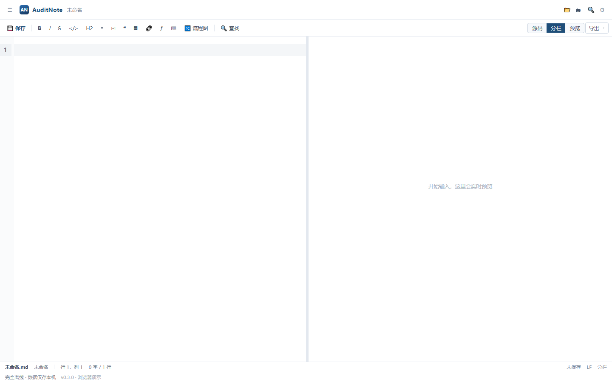
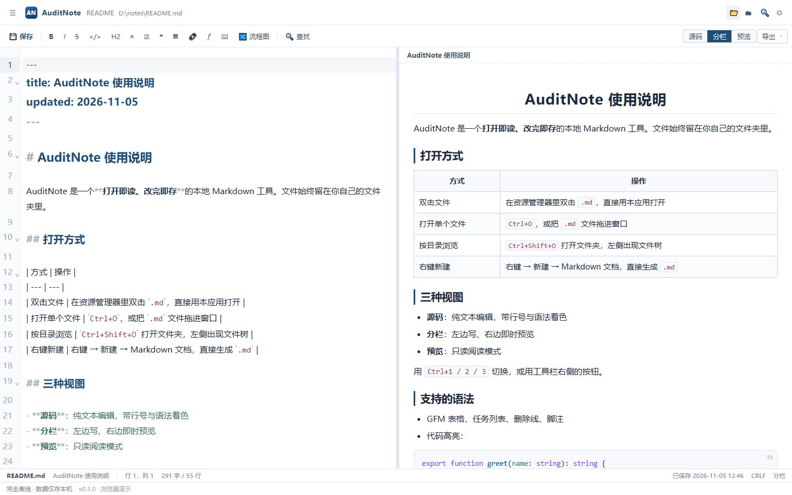
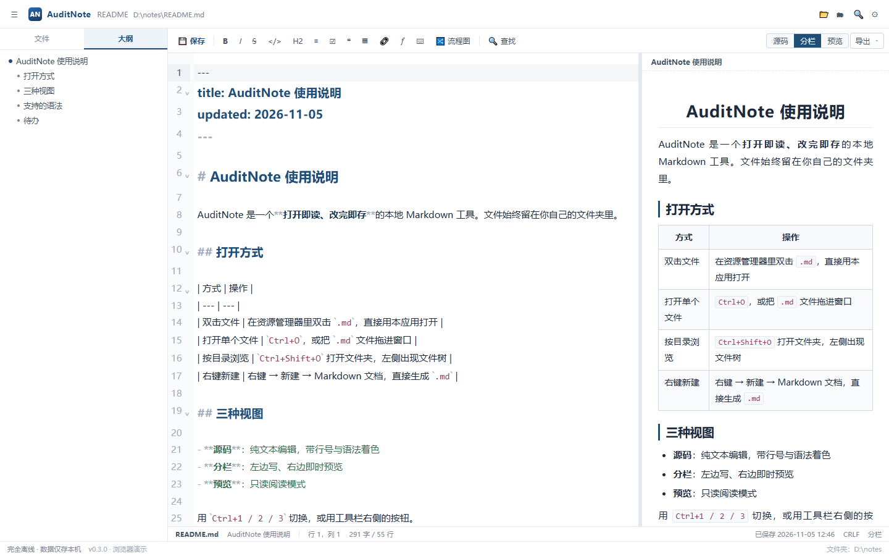
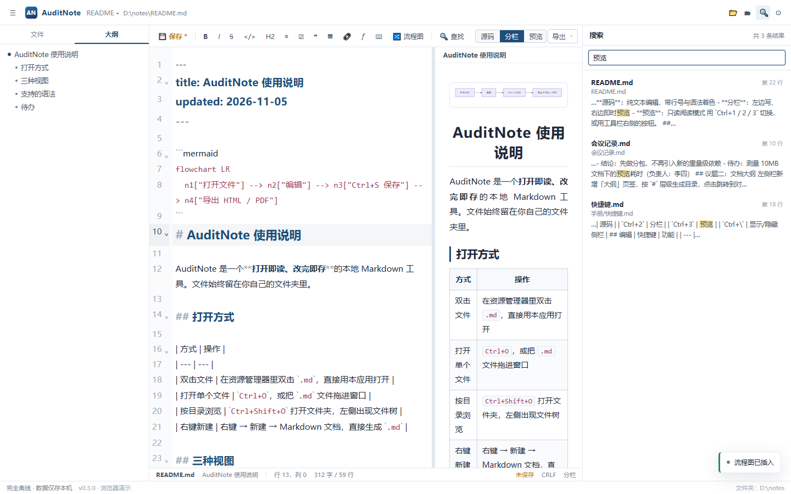
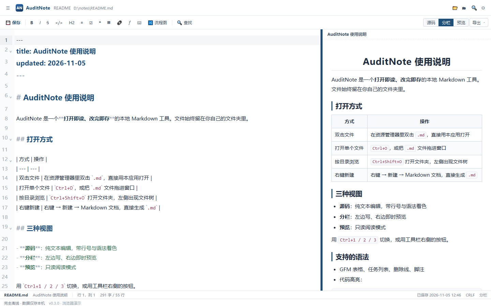
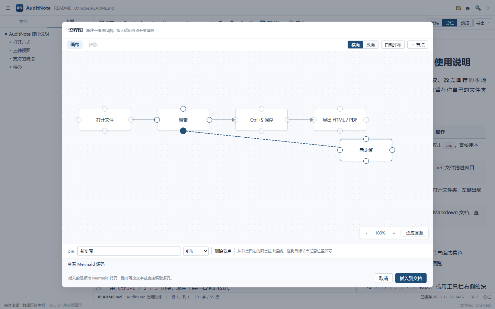
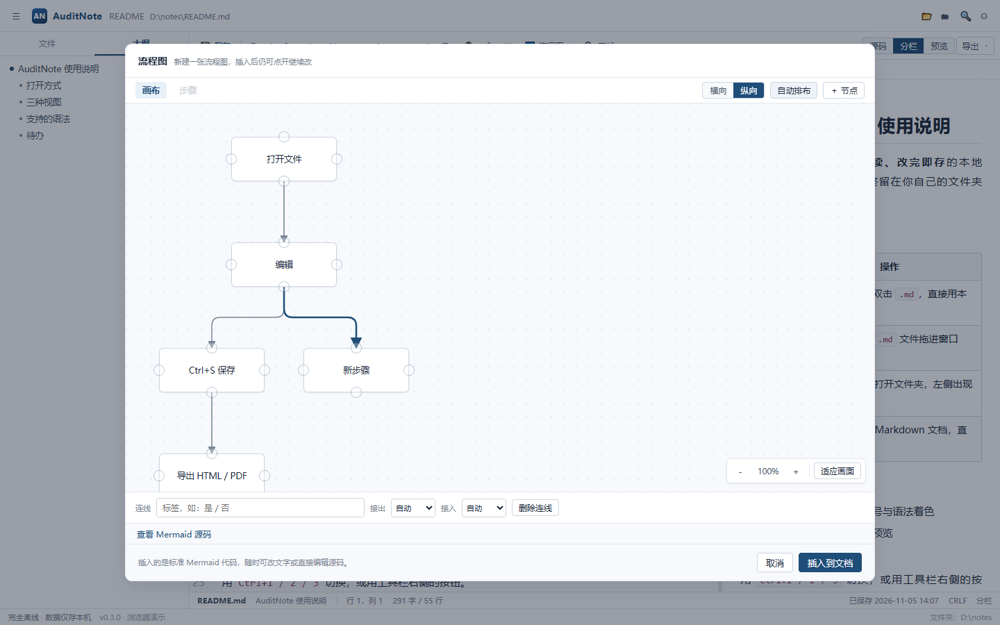

# AuditNote

> 像记事本一样存在的 Markdown 编辑器：**双击 `.md` 就用它打开，右键就能新建，打开即是一张空白页。**
> 不建库、不托管、不联云；文件留在你自己的磁盘上，工具只负责把它好看地读出来、顺手地改下去。

技术栈：**Tauri 2 + React 18 + TypeScript + Vite + CodeMirror 6 + markdown-it + SQLite(FTS5)**

更多界面截图见 [`docs/screenshots`](./docs/screenshots)。

---

## 界面一览

| 空白启动（无首页，直接可写） | 分栏编辑（源码 + 实时预览） |
| --- | --- |
|  |  |

| 文档大纲 | 跨文件搜索 |
| --- | --- |
|  |  |

| 拖动中间竖条调整分栏比例 | 从节点四边端口手绘连线 |
| --- | --- |
|  |  |

| 流程图：纵向自动排布 + 判断分支 |
| --- |
|  |

> 截图由 `scripts/ui-check.mjs` 用系统 Edge 注入 IPC mock 自动生成，不需要 Rust 环境即可回归界面。

---

## 1. 安装后怎么用（交付形态）

安装完成后，它就是你系统里的一个"文本编辑器"：

| 动作 | 结果 |
| --- | --- |
| **双击任意 `.md` / `.markdown`** | 直接用 AuditNote 打开，窗口标题就是文件名 |
| **右键 → 新建 → Markdown 文档** | 桌面/文件夹里生成 `新建 Markdown 文档.md`，双击即可编辑 |
| **开始菜单 / 桌面图标点开** | 不弹首页，直接给一张空白页，可以立刻打字（`Ctrl+S` 首次保存会问位置） |
| **已经开着窗口时再双击一个 `.md`** | 复用现有窗口打开该文件（单实例，不会开第二个进程） |
| **拖 `.md` 进窗口** | 窗口盖上「松开以打开文件」提示层，松手后**打开这个文件**（不是把内容插进当前文档）；拖入文件夹则直接当工作区打开 |

### 1.1 这些能力是怎么装上的

| 能力 | 实现 | 文件 |
| --- | --- | --- |
| 双击打开 | 安装包写入文件关联（ProgId + `.md/.markdown`），系统把文件路径作为命令行参数传入；后端读取 argv[1] 后交给前端 | `tauri.conf.json` 的 `bundle.fileAssociations`、`lib.rs:pick_doc_from_args`、`commands/app.rs:take_startup_file` |
| 复用窗口 | 单实例插件：第二次启动把参数转发给已有窗口并聚焦，然后自身退出 | `lib.rs`（`tauri-plugin-single-instance`） |
| 右键新建 | NSIS 安装钩子写 `HKCU\Software\Classes\.md\ShellNew\NullFile`，并通知 Shell 刷新 | `src-tauri/windows/hooks.nsh` |
| 拖入打开 | Tauri 原生拖放事件拿绝对路径；浏览器环境用 HTML5 drop 兜底。两者都在 capture 阶段拦下并 `stopPropagation`，避免 CodeMirror 把文件内容当文本插入 | `src/hooks/useExternalDrop.ts`、`src/lib/drop.ts` |
| 无首页 | 启动即 `openBlank()`，编辑器常驻；文档路径可为空 | `src/components/App.tsx`、`src/stores/editor.ts` |

> **用 MSI 安装或绿色版？** 关联与"新建"菜单不会自动写入，运行一次：
> ```powershell
> npm run shell:register        # 或：npm run shell:register -- -Exe "D:\path\AuditNote.exe"
> npm run shell:unregister      # 反向操作
> ```
> 脚本只写 `HKCU`（当前用户），不需要管理员权限；注册后若"新建"菜单没立刻出现，注销/登录一次或重启资源管理器。

---

## 2. 快速开始（开发）

### 2.1 环境要求

| 依赖 | 版本 | 说明 |
| --- | --- | --- |
| Node.js | ≥ 18（推荐 20 LTS） | 前端构建 |
| Rust | stable ≥ 1.77（**msvc** 工具链） | Tauri 后端 |
| VS Build Tools | 2019/2022，勾选「使用 C++ 的桌面开发」 | 提供 `cl.exe` 与 Windows SDK |
| WebView2 Runtime | Win10/11 通常自带 | 安装包已内置离线安装器 |

```powershell
winget install Rustlang.Rustup
winget install Microsoft.VisualStudio.2022.BuildTools
```

> **一键准备**：在项目根目录运行下面的脚本，会自动检测缺什么、装什么（弹一次 UAC），
> 并把 Rust 切到 MSVC 工具链、跑一次 `cargo check` 冒烟（首次约 5-15 分钟）：
>
> ```powershell
> powershell -NoProfile -ExecutionPolicy Bypass -File scripts\setup-build-env.ps1
> # 只想看状态、不安装：加 -CheckOnly
> ```
>
> 说明：Rust 只在**开发 / 打包安装包**时需要；普通用户安装 AuditNote 后使用不需要它。

### 2.2 安装与开发

```bash
npm install
npm run tauri:dev      # 开发模式（热更新）
```

> 只跑 `npm run dev` 得到的是纯浏览器页面，没有文件系统与 SQLite。**开发请用 `npm run tauri:dev`。**

### 2.3 只想先看界面？（不需要 Rust）

```bash
npm run build
node scripts/make-demo.mjs      # 生成 dist/__demo.html（注入 IPC mock）
npx vite preview --port 4173    # 打开 http://localhost:4173/__demo.html
```

演示页用内存模拟文件系统与索引：可以打开示例、编辑、拖动分栏、查找、画流程图、改设置，
分栏下还能**直接点击预览里的段落改字**；
带参数 `?file` 打开还能模拟"双击 .md 启动"。**不会真正读写磁盘**，刷新即还原。

### 2.4 检查与测试

```bash
npm test          # vitest，151 个用例
npm run lint      # ESLint（0 error）
npm run build     # tsc --noEmit + vite build
cd src-tauri && cargo test    # Rust 侧数据库单测（需 Rust 环境）
npm run perf:doc  # 生成压测用大文档（约 340KB / 5000+ 行）到 perf/压测文档.md
```

### 2.5 本地打包

一条命令搞定（自动定位 MSVC 与 Windows SDK，不依赖 vcvars 与 reg.exe）：

```bash
npm run build:app                    # 只出 exe，最快；双击即可运行，无需安装
npm run build:app -- -Bundle nsis    # 额外打 NSIS 安装包（含文件关联与"新建"菜单）
npm run build:app -- -Bundle msi     # 额外打 MSI 安装包
```

产物：

```
src-tauri/target/release/auditnote.exe                                  # 绿色可执行文件，约 7MB
src-tauri/target/release/bundle/nsis/AuditNote_0.3.0_x64-setup.exe      # 安装包，约 210MB（内置 WebView2 离线安装器）
```

`build:app` 只做两件事：配好 MSVC / Windows SDK 环境变量，然后调用 `tauri build`。
它把 release 的 LTO 放宽为 thin 并放开并行代码生成，首次构建从十几分钟降到几分钟，
运行性能无可测差异（交付配置仍在 `Cargo.toml` 的 `[profile.release]` 里）。

- `currentUser` 安装，无需管理员权限；
- 内置 WebView2 **离线安装器**（内网可用）；要减小体积可改 `webviewInstallMode` 为 `downloadBootstrapper`；
- 安装界面简体中文；**只有 NSIS 安装包会自动写入"右键新建"菜单**（见 1.1）。

### 2.6 性能自测

```bash
npm run perf:doc                                   # 生成 perf/压测文档.md
src-tauri\target\release\auditnote.exe perf\压测文档.md
```

按这份 342KB / 5342 行的文档实测（Windows 11 / WebView2，冷启动）：
窗口到标题显示文件名约 **1.0 秒**，其中包含 WebView2 冷启动与整篇渲染。
日常可关注这几处：滚动长文档是否掉帧、分栏下打字预览是否跟手、`Ctrl+F` 在长文档里的响应、
拖动分栏竖条是否跟手。若某处明显卡顿，优先看该文档里的 Mermaid 块数量（图渲染是主要开销）。

---

## 3. 目录结构

```
.
├─ index.html / package.json / package-lock.json
├─ vite.config.ts / vitest.config.ts / tsconfig.json / .eslintrc.cjs
├─ README.md / LICENSE
├─ assets/icon.png                 # 图标源图（1024，纯 Node 生成）
├─ scripts/
│  ├─ make-icon.mjs                # 画图标（超采样 + PNG 编码，无第三方库）
│  ├─ make-demo.mjs                # 生成浏览器演示页
│  ├─ ui-check.mjs                 # 注入 IPC mock + 系统 Edge 截图
│  └─ register-shell.ps1           # 手工注册/注销文件关联与"新建"菜单
├─ samples/notes/                  # 可直接打开体验的示例文件夹
├─ docs/screenshots/
│
├─ src/
│  ├─ main.tsx                     # 入口，按 URL 分流主界面 / 打印窗口
│  ├─ types.ts
│  ├─ components/                  # App / Sidebar / EditorPane / Toolbar / FindBar / Preview / StatusBar / FlowDialog / 弹窗
│  ├─ editor/                      # CodeMirror 6：Editor.tsx / bridge.ts / theme.ts
│  ├─ lib/                         # 纯逻辑：markdown / frontmatter / find / outline / flow / export-html / text / newdoc
│  ├─ services/                    # api.ts（命令封装）、export.ts（导出编排）
│  ├─ stores/                      # zustand：settings / workspace / editor / ui / toast
│  ├─ assets/logo.png              # 界面上的品牌标识
│  ├─ styles/global.css            # 样式与三套主题变量
│  └─ views/PrintView.tsx          # 打印窗口
│
├─ src-tauri/
│  ├─ Cargo.toml / Cargo.lock / tauri.conf.json
│  ├─ capabilities/default.json
│  ├─ windows/hooks.nsh            # NSIS 钩子：ShellNew（右键新建）+ 刷新
│  ├─ icons/                       # 32/128/256… + icon.ico / icon.icns
│  └─ src/
│     ├─ lib.rs                    # AppState、单实例、启动参数、命令注册、损坏库自愈
│     ├─ models.rs / fsops.rs / db.rs (+ db/tests.rs)
│     └─ commands/                 # app / file / workspace / index / drafts
└─ tests/                          # 前端单测（151 例）
```

---

## 4. 架构说明

### 4.1 前后端职责

| 层 | 负责 | 不负责 |
| --- | --- | --- |
| Rust | 文件读写与原子落盘、文件夹扫描、软删除、SQLite、启动参数与单实例、打印窗口 | 不做 Markdown 解析与渲染 |
| React | 界面、CodeMirror、markdown-it 渲染、导出内容组装、状态管理 | 不直接碰 `fs`，全部走命令 |

### 4.2 双击打开一条文件的链路

```
资源管理器双击 .md
  → 系统按 ProgId 启动 AuditNote.exe "D:\notes\README.md"
  → Rust: pick_doc_from_args() 取出路径，放进 AppState.startup_file
  → 前端启动后 take_startup_file() 取一次（读完清空）
  → editor.open(path) → 读盘、渲染预览、建索引
  → 之后按 Ctrl+S 原子写回（临时文件 + rename，保留原 CRLF/LF）
```

应用已在运行时再双击：单实例插件收到 argv，`emit("open-file", path)` 给已有窗口，并聚焦窗口。

### 4.3 数据存放

| 内容 | 位置 |
| --- | --- |
| 正文 | 你自己的文件夹，原样 `.md`（UTF-8，保留原换行符） |
| 索引 / 草稿 | `%APPDATA%\com.auditnote.desktop\auditnote.db`（WAL） |
| 软删除 | `<打开的文件夹>/.auditnote/trash/<时间戳>_<原名>` |

**中文检索**：FTS5 用 `trigram` 分词器（`unicode61` 对中文子串无效），关键词 < 3 字符或 FTS5 不可用时降级 `LIKE`。

---

## 5. 功能与快捷键

### 5.1 快捷键

| 快捷键 | 功能 |
| --- | --- |
| `Ctrl+N` | 新建空白文档 |
| `Ctrl+O` / `Ctrl+Shift+O` | 打开文件 / 打开文件夹 |
| `Ctrl+S` / `Ctrl+Shift+S` | 保存 / 另存为 |
| `Ctrl+W` | 关闭当前文档（回到空白页） |
| `Ctrl+1/2/3` | 源码 / 分栏 / 预览 |
| `Ctrl+\` | 显示/隐藏侧栏 |
| `Ctrl+F` | 文内查找替换 |
| `Ctrl+Shift+F` | 跨文件搜索 |
| `Ctrl+B` / `Ctrl+I` / `Ctrl+K` | 加粗 / 斜体 / 链接 |
| `Ctrl+Shift+T` | 插入表格 |
| `Ctrl+,` | 设置 |
| `Esc` | 关闭查找条 / 抽屉 |

### 5.2 能力清单

- **三视图**：源码 / 分栏 / 纯预览；中间竖条可拖动（20%~80%，双击复位 50/50，比例记忆）
- **预览区直接改**：分栏下点击预览里的任意段落/标题/列表/表格/引用，**就在渲染结果上打字**
  （不弹任何编辑框），左侧源码实时同步、撤销历史也在；标题级别、列表符号、任务勾选框都会原样保留；
  公式、Mermaid 图表是生成物，仍走左侧源码；点击别处或 `Esc` 退出编辑并重渲染；
  行号换算带 front matter 偏移，左侧刚被改过时放弃这次编辑并提示，不写错位置；
  滚动任一侧另一侧按比例跟随（防回声抑制窗口，不会来回拉扯）
- **拖入即打开**：把 `.md` / `.markdown` / `.txt` 拖进窗口 → 打开该文件（拖入文件夹则打开为工作区）；
  当前文档有未保存改动时先弹确认（「保存并打开」/「放弃更改」），避免误拖把内容顶掉；
  文档内拖文字、侧栏拖节点不受影响（只接管带 `Files` 的拖动）
- **左栏两页签**：文件树（需打开文件夹，打开后自动展开）/ 文档大纲（点击跳行）
- **查找替换**：顶部内嵌，命中计数、上下切换、区分大小写、全部替换；
  **三种视图都生效**——源码视图高亮左侧、分栏两边同时高亮、纯预览视图直接在渲染结果上高亮并滚动定位，
  计数按"页面上真正亮出来的处数"走（front matter、公式/图表源码里不渲染的命中不计入）
- **工具栏**：加粗/斜体/删除线/行内代码；**标题下拉（一级 / 二级 / 三级）**；
  **无序列表、有序列表（数字 `1.` / 括号 `1)` / 宽松模式 / 从指定编号开始）**、任务列表、引用、表格、链接、公式、代码块
- **流程图**：两种编辑方式——**画布**（拖节点、从四边端口拉线连关系、判断节点拉"是/否"两条线）与**步骤**（线性流程快速输入）；
  连线为正交圆角走线、带标签胶囊，可单独设置接出/接入方向（上/右/下/左）；画布支持 Ctrl+滚轮缩放、拖动空白平移、
  一键适应画面，画布范围 1600×1000 起并随节点自动扩张；自动排布按最长路径分层 + 重心排序减少交叉，
  纵向时同层等距居中、行距恒定为 152px、单入单出节点上下对齐；
  插入的是标准 Mermaid，光标在图内再点一次可回填继续改，坐标存在 `%% pos`、接出方向存在 `%% port` 注释里所以布局不会乱
- **导出**：HTML（单文件离线）/ PDF（系统打印引擎，中文零字体风险）
- **健壮性**：原子写、5 秒草稿、外部修改提示、非 UTF-8 提示、索引损坏自愈

---

## 6. 图标


- **设计**：深青绿渐变圆角方块 + 白色 `M` 字形，右腿向下延伸成箭头——"Markdown + 向下书写"，
  与官方 `M↓` 的并排造型区分开；纯几何构成，缩到 16px 仍能认出轮廓。
- **适配**：图标自带底色，浅色/深色壁纸、任务栏、开始菜单、文件关联图标均能立住；16/24/32/48/64/128/256 与 `.ico` 多尺寸齐备。
- **重生成**：`node scripts/make-icon.mjs && npm run icons`（源图 `assets/icon.png` 由纯 Node 绘制，3 倍超采样抗锯齿）。

---

## 7. 已知限制

1. **目前只在 Windows 上验证**：文件关联、右键新建、打印导出都基于 Windows 实现。
2. **文件关联要安装后才生效**：开发模式（`tauri:dev`）下系统的 `.md` 仍指向原默认程序，
   可用 `npm run shell:register` 手工指向开发版自测。
3. **只有 NSIS 安装包写「右键新建」菜单**；MSI / 绿色版需运行一次 `npm run shell:register`。
4. **PDF 需要自己选一下**：走系统打印对话框里的「另存为 PDF」，不是一键落盘。
5. **不做 WYSIWYG 与多标签页**：预览区就地编辑回写的仍是 Markdown 源码，一次只编辑一个文档。
6. **安装包偏大**（内置 WebView2 离线安装器约 +130MB）；内网/离线环境推荐保留，能联网可改
   `webviewInstallMode` 为 `downloadBootstrapper` 把体积降到 10MB 以内。

---

## 8. 常见问题

**Q：双击 .md 没有用 AuditNote 打开？**
A：说明关联没写成功。先确认是 NSIS 安装包安装的；否则运行 `npm run shell:register`，
再在文件右键「打开方式 → 选择其他应用 → AuditNote → 始终使用」。

**Q：右键"新建"里没有 Markdown 文档？**
A：ShellNew 只在 NSIS 安装时写入。手动执行 `npm run shell:register`，然后重启资源管理器
（任务管理器 → 重启"Windows 资源管理器"）。

**Q：启动后是一张空白页，我的文件呢？**
A：这是记事本式设计——点开程序就是空白文档。要打开文件用 `Ctrl+O`，或直接在资源管理器双击。

**Q：搜索没有结果？**
A：跨文件搜索需要先打开**文件夹**；仍无结果时在左下角点「重建索引」。

**Q：PDF 里中文变方框？**
A：本方案由系统打印引擎输出，不会缺字体。若出现，检查是否选了虚拟打印机，改用「Microsoft Print to PDF」。

**Q：怎么卸载干净？**
A：卸载程序会删除 `ShellNew` 注册项；若还残留关联，运行 `npm run shell:unregister`。

---

## 许可证

[MIT](LICENSE) © 2026 Hejunlong27

可自由使用、修改、分发，包括商业用途；保留版权声明与许可声明即可。
