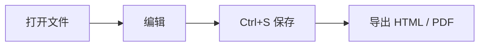

# AuditNote 使用说明

AuditNote 是一个**打开即读、改完即存**的本地 Markdown 工具。文件始终留在你自己的文件夹里。

## 打开方式

| 方式 | 操作 |
| --- | --- |
| 双击文件 | 在资源管理器里双击 `.md`，直接用本应用打开 |
| 打开单个文件 | `Ctrl+O`，或把 `.md` 文件拖进窗口 |
| 按目录浏览 | `Ctrl+Shift+O` 打开文件夹，左侧出现文件树 |
| 右键新建 | 右键 → 新建 → Markdown 文档，直接生成 `.md` |

## 三种视图

- **源码**：纯文本编辑，带行号与语法着色
- **分栏**：左边写、右边即时预览
- **预览**：只读阅读模式

用 `Ctrl+1 / 2 / 3` 切换，或用工具栏右侧的按钮。

## 支持的语法

- GFM 表格、任务列表、删除线、脚注
- 代码高亮：

```ts
export function greet(name: string): string {
  return `你好，${name}`;
}
```

- 数学公式（KaTeX）：

$$
T = \frac{1}{f} = \frac{2\pi}{\omega}
$$

- Mermaid 图表：



## 待办

- [x] 打开文件即渲染
- [x] 分栏预览与滚动同步
- [ ] 记住每个文件的滚动位置

> 提示：按 `Ctrl+F` 可在文内查找替换，`Esc` 关闭查找条。
